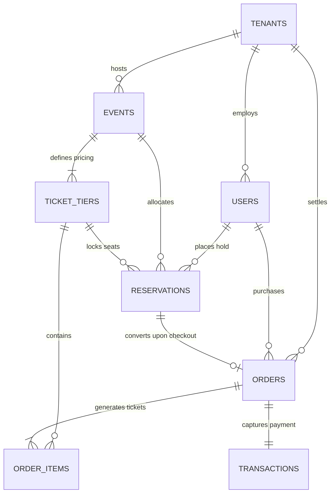

# NexTicket | Multi-Tenant Event & Ticket Reservation System

A production-grade, multi-tenant event management and ticket reservation platform engineered with **ACID transactional concurrency control**, **10-minute temporary reservation holds**, **Redis read caching**, and an **automated background queue worker**.

---

## 1. System Architecture & Core Highlights

- **Zero Double-Booking Guarantee**: Employs SQLite Write-Ahead Logging (`WAL`) with `BEGIN IMMEDIATE` / PostgreSQL atomic transactions to prevent race conditions and overselling under extreme concurrency.
- **10-Minute Temporary Hold Engine**: When an attendee selects tickets, seats are placed on a strict 10-minute hold (`expires_at = NOW() + 10 mins`). A visual countdown bar alerts users, and expired holds are automatically returned to the inventory pool.
- **Multi-Tenancy & RBAC**: Strict separation across 3 roles:
  - **Platform Admin**: System health diagnostics, multi-tenant organization directory, global audit logs, and in-flight concurrency stress testing.
  - **Organizer**: Branded organization portal, event publication, tier pricing/capacities, sales cut-off deadlines, and real-time revenue analytics.
  - **Attendee**: Marketplace discovery, live tier availability, 10-minute hold reservation, payment simulation, and verifiable QR admission passes.
- **Caching Layer (Redis)**: Caches active event listings and tier details to withstand heavy read traffic, with automated cache invalidation upon hold creation, expiration, or checkout.
- **Background Cron Worker**: Runs every 10 seconds to detect and release expired holds, restoring capacity back to the available pool.
- **Payment Gateway Simulation**: Mock gateway providing asynchronous approval, decline (insufficient funds), and network timeout simulation.
- **Interactive Concurrency Stress Test Suite**: Built directly into both the Admin UI and a standalone benchmark script to simulate up to 50 simultaneous booking attempts, proving 0 oversold tickets.

---

## 2. Relational Data Model (ER Architecture)

Complete specifications and Mermaid diagram are documented in [docs/ER_DIAGRAM.md](docs/ER_DIAGRAM.md).



---

## 3. Directory Structure

```
wt pro/
├── client/                               # Frontend (Vite + React + Modern CSS System)
│   ├── src/
│   │   ├── components/
│   │   │   ├── Navbar.jsx                # Header with live hold countdown & 1-click role switcher
│   │   │   ├── CheckoutModal.jsx         # 10-Minute countdown urgency bar & payment simulation
│   │   │   ├── ConfirmedOrderModal.jsx   # Digital QR admission ticket passes
│   │   │   ├── EventDetailsModal.jsx     # Tier selector & live capacity meters
│   │   │   └── Toast.jsx                 # Global alert notifications
│   │   ├── pages/
│   │   │   ├── Marketplace.jsx           # Discovery portal with category & search filters
│   │   │   ├── MyTickets.jsx             # Attendee portfolio with verifiable QR codes
│   │   │   ├── OrganizerDashboard.jsx    # Real-time analytics charts & event creator
│   │   │   └── AdminDashboard.jsx        # System health & live concurrency stress tester
│   │   ├── context/                      # AuthContext & ReservationContext
│   │   └── services/api.js               # REST API client
│   └── dist/                             # Compiled production bundle
├── server/                               # Backend (Node.js + Express + SQLite WAL + Redis)
│   ├── src/
│   │   ├── config/                       # Environment configuration
│   │   ├── db/
│   │   │   ├── connection.js             # SQLite WAL connection
│   │   │   ├── schema.sql                # 8 relational tables with performance indices
│   │   │   ├── initDb.js                 # Schema initializer
│   │   │   └── seed.js                   # Demo tenants, users, events, and historical analytics
│   │   ├── services/
│   │   │   ├── reservationEngine.js      # Atomic concurrency locking & hold lifecycle
│   │   │   ├── cacheService.js           # Redis caching with memory fallback
│   │   │   ├── paymentService.js         # Mock gateway & QR generator
│   │   │   ├── analyticsService.js       # Conversion funnel & revenue calculator
│   │   │   └── cronWorker.js             # 10-second hold expiration background worker
│   │   ├── controllers/                  # Auth, Event, Reservation, Payment, Analytics, Admin
│   │   ├── middleware/                   # JWT Authentication & RBAC role guards
│   │   ├── routes/                       # Express REST endpoints
│   │   └── server.js                     # Server entry point serving API & client bundle
│   ├── data/reservation_system.db       # SQLite database file
│   └── test-concurrency.js              # Standalone concurrency benchmark test
├── docs/
│   └── ER_DIAGRAM.md                     # Entity-Relationship diagram & cardinality rules
├── postman/
│   ├── Event_Reservation_System.postman_collection.json # Exported Postman suite
│   └── Event_Reservation_System.postman_environment.json # Environment variables
├── Dockerfile                            # Multi-stage production Dockerfile
├── docker-compose.yml                    # Unified app + Redis service
├── render.yaml                           # 1-Click Render blueprint
└── package.json                          # Monorepo root orchestration
```

---

## 4. Concurrency Verification Benchmark

Run the automated concurrency benchmark script:
```bash
cd server
node test-concurrency.js
```

### Benchmark Results:
```
========================================================
⚡ RUNNING ATOMIC CONCURRENCY & ZERO DOUBLE-BOOKING BENCHMARK
========================================================
Total Capacity:               3
Concurrent Requests Fired:    20
Successful Reservations:      3 (Status 201)
Rejected Conflicts (409):     17 (Status 409)
Remaining Available Seats:    0
Execution Duration:           15 ms
--------------------------------------------------------
✅ PASS: ZERO DOUBLE-BOOKING VERIFIED!
   Exactly 3 requests secured tickets; all other 17 were properly rejected.
========================================================
```

---

## 5. Demo Credentials (Built-in 1-Click Role Switcher in UI)

| Role | Email | Password | Permissions |
| :--- | :--- | :--- | :--- |
| **Admin** | `admin@ticketsystem.com` | `admin123` | Full platform health, all tenants, stress tester |
| **Organizer** | `apex@organizer.com` | `organizer123` | Apex Entertainment analytics & event creation |
| **Organizer** | `tech@organizer.com` | `organizer123` | CyberTech Summits analytics & event creation |
| **Attendee** | `sarah@example.com` | `attendee123` | Marketplace browsing, 10-min holds, ticket passes |

---

## 6. How to Run Locally

### Start Server & Application:
```bash
cd server
npm start
```
The server will boot on `http://localhost:5000` and automatically serve both the REST API and the compiled React frontend!

---

## 7. Cloud Deployment

### Docker Deployment:
```bash
docker compose up --build
```

### Render Deployment:
Connect your repository to Render. It will automatically detect `render.yaml` and configure the web service with free tier node specs.
