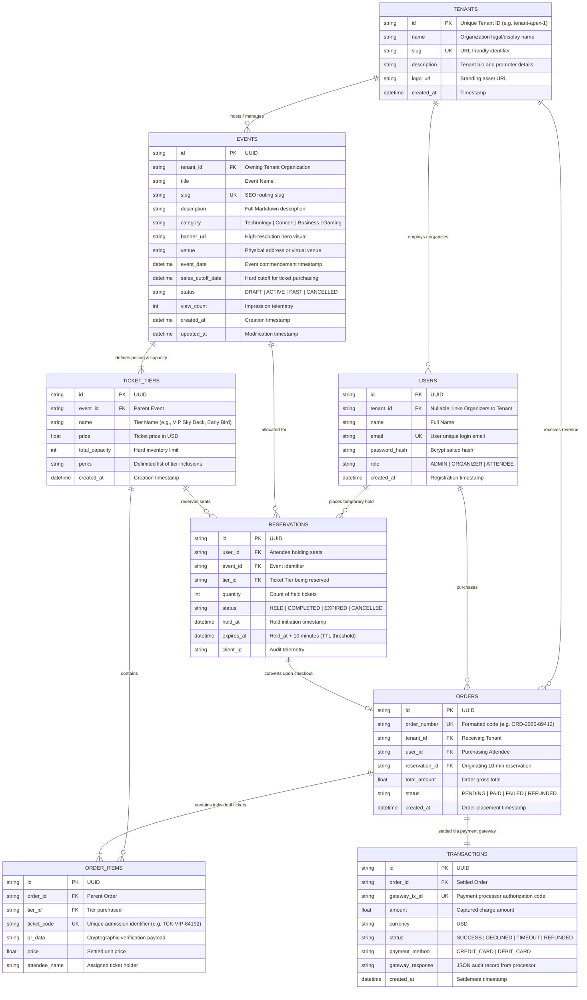

# Entity-Relationship (ER) Diagram & Data Architecture

## Multi-Tenant Event & Ticket Reservation System

This document outlines the relational data model, entity relationships, constraint enforcement, and concurrency isolation boundaries of the platform.

---

### 1. Visual Mermaid ER Diagram



---

### 2. Relational Schema & Cardinality Specifications

| Relation | Cardinality | Business Rule & Integrity Enforcement |
| :--- | :--- | :--- |
| **Tenants $\to$ Events** | `1 : N` | Each event is hosted by exactly one organization (Tenant). Deleting a tenant cascades to all events hosted by that organization. |
| **Tenants $\to$ Users** | `1 : N` | An `ORGANIZER` belongs to an assigned Tenant. Platform `ADMIN` and `ATTENDEE` users have `tenant_id = NULL`. |
| **Events $\to$ Ticket Tiers** | `1 : N` | An event defines one or more tiered ticket types (e.g. VIP, General Admission). Each tier maintains its own capacity ceiling. |
| **Ticket Tiers $\to$ Reservations** | `1 : N` | High-concurrency allocation pool. Available inventory is dynamically computed as: $\text{Available} = \text{Capacity} - (\sum \text{Paid} + \sum \text{Active Holds})$. |
| **Reservations $\to$ Orders** | `1 : 1` | A valid temporary reservation converts into an `Order` upon successful payment authorization before `expires_at`. |
| **Orders $\to$ Order Items** | `1 : N` | If an order reserves 3 VIP tickets, 3 individual `order_items` are generated, each with a unique barcode/QR verification code. |
| **Orders $\to$ Transactions** | `1 : 1` | Every confirmed order contains a verifiable transaction log storing gateway audit records and auth tokens. |

---

### 3. Concurrency Invariants & Double-Booking Protection

```
Available Inventory = Total Tier Capacity - (Confirmed Orders + Active Unexpired Holds)
```

1. **Transactional Isolation**: All reservation attempts execute inside an immediate transaction (`BEGIN IMMEDIATE` in SQLite / `SELECT ... FOR UPDATE` in PostgreSQL).
2. **Atomic Verification**: The transaction queries both active holds (`expires_at > NOW() AND status = 'HELD'`) and confirmed sales before validating `quantity <= Available`.
3. **Automatic Hold Expiration**: Expired reservations (`expires_at <= NOW()`) are purged by a background worker every 10 seconds, releasing tickets without manual intervention.
